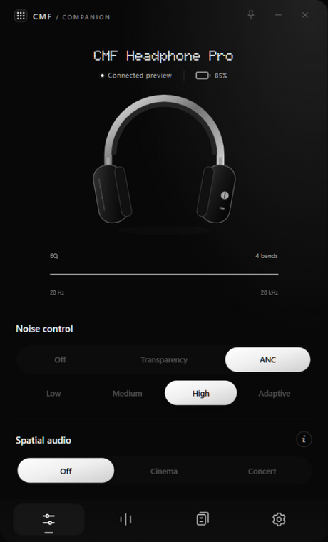
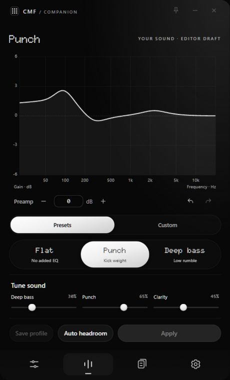
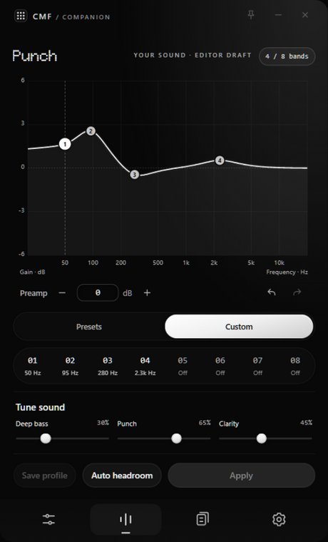
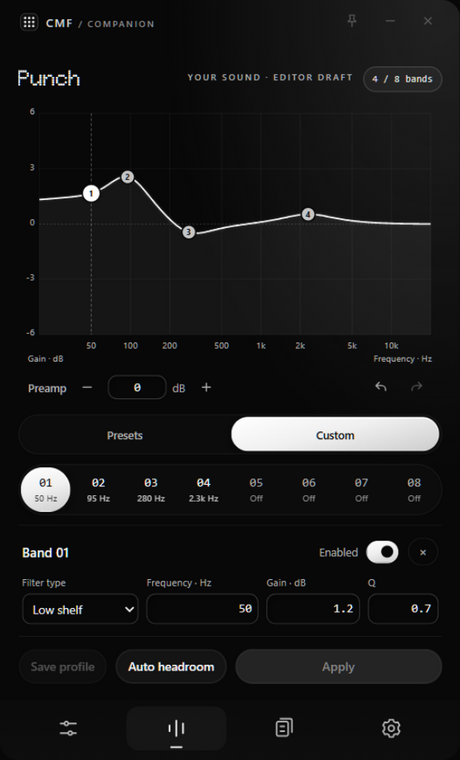
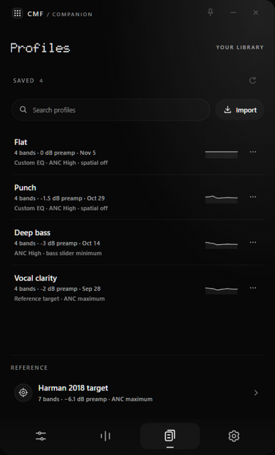

<div align="center">


# CMF Companion

**An unofficial companion app for the CMF Headphone Pro (B175), for Windows and Android.**

Edit the headphones' 8-band parametric EQ, control ANC and spatial audio, and keep your own
library of tuning profiles — over the same Bluetooth control protocol Nothing X uses.

[](https://github.com/vinayak-mv/CMF-Companion/actions/workflows/build.yml)
[](https://github.com/vinayak-mv/CMF-Companion/actions/workflows/android.yml)

</div>

---

## What it does

Nothing X gives you a handful of sliders. CMF EQ exposes the filter bank behind them: type,
frequency, gain and Q for every band, a real preamp, and an editor that shows the curve you are
about to send.

| | |
|---|---|
| **Equalizer** | Draggable 8-band response editor, per-band filter type / frequency / gain / Q, preamp with a calculated peak estimate, Deep bass / Punch / Clarity tone sliders, and Flat / Punch / Deep bass starting points. |
| **Profiles** | A local library of named tunings with search, calculated response thumbnails, rename / update / delete with undo, and AutoEQ / Equalizer APO `.txt` import and export. Includes a Harman 2018 target reference. |
| **Headphones** | Noise control (Off / Transparency / ANC with Low, Medium, High, Adaptive), spatial audio (Off / Concert / Cinema), and battery level. |
| **On launch** | The EQ stored in the headphones is read once at connect and opened in the editor, so you start from what is actually on the device. |

Every EQ change is a **draft** until you press **Apply**. Applying shows a review dialog
with the exact bands, then writes them and reads them back to confirm.

## Screenshots

<p align="center">
  
  
  
</p>
<p align="center">
  
  
</p>

## Compatibility

- **Headphones:** CMF Headphone Pro (B175).
- **Windows:** Windows 10 or later, using the Win32 Bluetooth stack. The app connects over
  RFCOMM to the headset's control service.
- **Android:** Android 7.0+ (minSdk 24), ARM64. Control traffic goes through a small Kotlin
  RFCOMM bridge; all protocol framing stays in Rust.
- **Firmware:** settings are read from the device at connect instead of assumed. Future
  firmware that changes a response format will surface as a readback warning rather than a
  silent wrong value.

## Install

Download the assets from the
[latest release](https://github.com/vinayak-mv/CMF-Companion/releases/latest):

- **Windows 10+:** `cmf-eq-windows-x64.exe`. The binary is unsigned, so Windows SmartScreen may
  ask you to confirm.
- **Android 7+ (ARM64):** `cmf-eq-android-arm64.apk`. Debug-signed; sideload it and allow
  installs from unknown sources.

Every `v*` tag publishes a release with both binaries — see [RELEASING.md](RELEASING.md). Untagged
development builds are also uploaded as seven-day workflow artifacts.

## Build from source

The frontend is dependency-free vanilla JavaScript. There is no bundler and no npm build step;
`npm` is only used to launch the Tauri CLI.

### Windows

```powershell
cargo build --release --features desktop --locked
# -> target/release/cmf-eq.exe
```

### Android

Requires Node 22, JDK 17, Android SDK platform 36, build-tools 36.0.0 and NDK 28.2.13676358.

```bash
npm ci --ignore-scripts
npx --no-install tauri icon ui/brand-mark.svg --output icons/android
npx --no-install tauri android init --ci --skip-targets-install
python tools/prepare_android.py     # installs the Kotlin transport + manifest permissions
npx --no-install tauri android build --debug --apk --target aarch64 --features app --ci
```

`tools/prepare_android.py` is not optional: the generated project is recreated from scratch by
`tauri android init`, and the script is what installs the Bluetooth plugin and permissions into it.

## Using it

1. Pair the CMF Headphone Pro in your OS Bluetooth settings.
2. Open CMF EQ and press **Connect headphones**. It autoconnects on launch when the headphones
   are paired and in range.
3. Close Nothing X if it is holding the control connection.

Settings are read once when the connection opens. If a readback looks wrong, disconnect and
reconnect rather than expecting a refresh button.

## How it works

```
ui/                     Dependency-free frontend (vanilla JS + CSS, no bundler)
  app.mjs               App state, connection flow, write/review dialogs
  graph-editor.mjs      Draggable SVG response editor (never invokes Tauri)
  tuning.mjs            Presets, tone-slider mapping, headroom estimate, .txt export
  response.mjs          RBJ biquad magnitude response
  profile-library.mjs   Local profile library UI
src/
  protocol.rs           Packet framing, CRC-16/ARC, EQ and battery codecs — no sockets
  bluetooth.rs          Session, settings reads/writes, verified write states
  autoeq.rs             Equalizer APO parser, Profile/Filter types, validation
  profile_library.rs    Named local profiles, validated and lock-protected
  gain_record.rs        Staged one-dB gain-undo record
  app.rs                Thin Tauri commands over the layers above
```

All Bluetooth I/O is blocking and runs off the UI thread. The protocol layer is pure bytes,
which is why it is testable without hardware. Android substitutes a Kotlin RFCOMM socket behind
the same transport surface; every framing and write decision stays in Rust.

## Development

The UI runs in a browser without the Rust app. `app.mjs` falls back to mock data when the Tauri
bridge is absent:

```bash
python -m http.server 8765 --directory ui
```

- `http://127.0.0.1:8765/index.html?preview=connected` — populated connected view
- `http://127.0.0.1:8765/index.html` — disconnected view

The desktop window is a fixed, undecorated 460×760 panel, so the layout is designed to keep all
eight bands visible without page scrolling.

Protocol tests (no `--features app`, no hardware):

```bash
cargo test --lib
```

## Contributing

Issues and pull requests are welcome. A few ground rules:

- Keep the frontend dependency-free — the CSP is `script-src 'self'`, so no CDN and no inline
  scripts.
- Keep user-facing copy honest: response curves are calculated estimates, not measurements.
- Preserve the write-safety invariants above when touching the write path.

## Limitations

- Not affiliated with, endorsed by, or supported by Nothing or CMF.
- The control protocol is reverse-engineered. A firmware update can change it.
- The headphones do not report a profile name, only filter values, so the EQ read at launch is
  labelled **Headphone EQ**.
- Windows and Android only. macOS and Linux have no transport implementation.

## License

No license has been declared for this repository yet.
